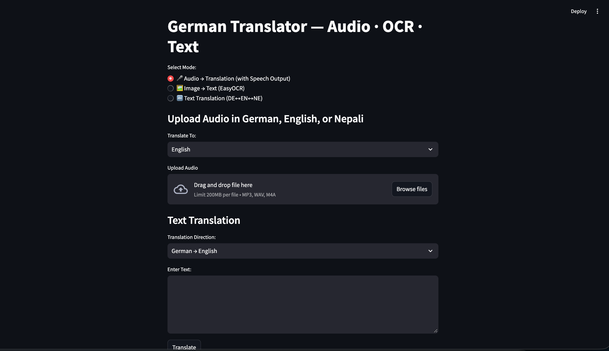
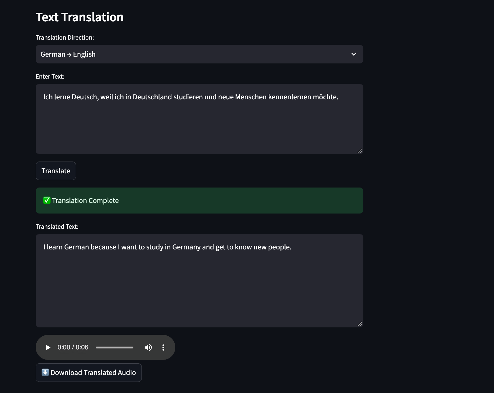
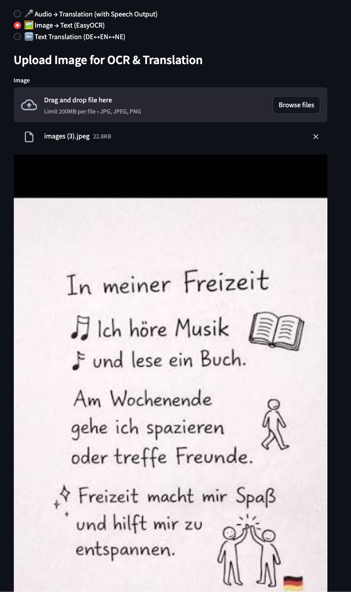
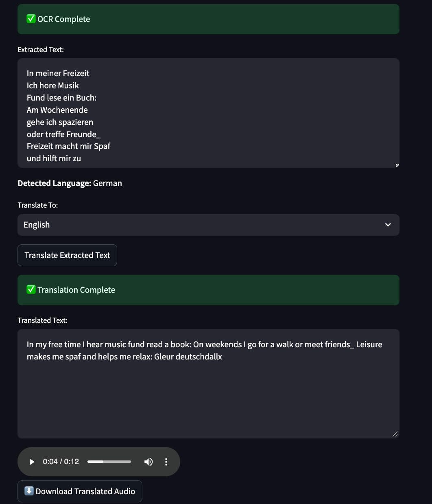

# German Tutor — Multilingual Translation Assistant

A Streamlit-based multilingual translation prototype combining text translation, audio transcription, image-based text extraction (OCR), and text-to-speech in a single application.

Developed as an academic project, German Tutor explores how machine learning and speech-processing tools can make language translation more accessible, particularly for learners working across German, English, and Nepali.

## Overview

German Tutor brings multiple language-processing workflows into one interface. Users can enter text, upload audio, or upload an image containing text and process the content through the application's translation and speech workflows.

The application combines pretrained NLP models, speech recognition, OCR, language detection, and speech synthesis.

## Features

### 1. Text Translation

- Translate text between supported languages.
- German–English translation.
- English–Nepali translation.
- German–Nepali translation workflow through English.
- Simple interface for entering text and selecting translation direction.

### 2. Audio Translation

- Upload audio files for processing.
- Audio transcription using Whisper.
- Translation of transcribed text.
- Speech output using text-to-speech.
- Playback and download of generated audio.

Supported audio upload formats include MP3, WAV, and M4A.

### 3. Image OCR

- Upload images containing printed or written text.
- Extract text using EasyOCR.
- Detect the language of extracted text.
- Translate extracted text into a selected target language.
- Generate speech output from translated text.

Supported image formats include JPG, JPEG, and PNG.

### 4. Text-to-Speech

Translated text can be converted into speech for listening and language practice.

Users can play the generated audio directly in the application and download the audio output.

## Application Workflow

### Text Translation

Text Input → Select Translation Direction → Translation → Audio Output

### Audio Translation

Audio Upload → Speech Recognition → Transcribed Text → Translation → Speech Output

### Image OCR

Image Upload → OCR Text Extraction → Language Detection → Translation → Speech Output

## Screenshots

### Main Interface





## Technology Stack

| Technology | Purpose |
|---|---|
| Python | Application logic |
| Streamlit | Web interface |
| Hugging Face Transformers | Translation models |
| MarianMT | Machine translation |
| Whisper | Speech recognition and transcription |
| EasyOCR | Image text extraction |
| gTTS | Text-to-speech generation |
| PyTorch | Machine learning framework |
| Langdetect | Language detection |
| Librosa | Audio processing |
| Pillow | Image handling |

## Models Used

| Model / Library | Application |
|---|---|
| `Helsinki-NLP/opus-mt-de-en` | German to English translation |
| `Helsinki-NLP/opus-mt-en-de` | English to German translation |
| `Hemg/english-To-Nepali-TRanslate` | English to Nepali translation |
| `iamTangsang/MarianMT-Nepali-to-English` | Nepali to English translation |
| `openai/whisper-base` | Audio transcription |
| EasyOCR | Image text extraction |

## Installation

### Requirements

- Python
- FFmpeg
- Git

### Setup

Clone the repository:

```bash
git clone https://github.com/raverer/German-Tutor.git
cd German-Tutor
```

Create a virtual environment:

```bash
python -m venv .venv
```

Activate it:

**macOS / Linux**

```bash
source .venv/bin/activate
```

Install dependencies:

```bash
pip install -r requirements.txt
```

Run the application:

```bash
streamlit run app.py
```

The application will open in your browser.

## Project Structure

```text
German-Tutor/
├── app.py
├── requirements.txt
├── packages.txt
├── runtime.txt
├── streamlit.toml
├── assets/
│   └── screenshots/
│       ├── 01-main-interface.png
│       ├── 02-text-translation.png
│       ├── 03-ocr-input.png
│       └── 04-ocr-result.png
└── README.md
```

## Limitations

This project is a functional prototype and has limitations:

- Audio language handling relies partly on heuristics.
- Whisper transcription currently uses an English-language hint in the workflow, which can affect transcription accuracy for other languages.
- OCR accuracy depends on image quality, font, contrast, layout, and handwriting.
- OCR processing currently uses an English-configured reader, which may affect multilingual text extraction.
- German–Nepali translation may use English as an intermediate language.
- Translation and transcription quality have not been formally benchmarked.
- Processing time depends on the hardware and model loading requirements.

These limitations represent opportunities for further development, including improved language identification, multilingual OCR, model evaluation, better audio handling, and interface refinement.

## Future Improvements

- More robust multilingual speech recognition.
- Improved language detection.
- Multilingual OCR support.
- Translation quality evaluation.
- Better handling of long audio files.
- Improved error handling and temporary-file management.
- User experience and interface improvements.

## Academic Context

German Tutor was developed as an academic project exploring the integration of machine learning-based translation, speech recognition, OCR, and speech synthesis into a practical language-processing application.

The project demonstrates the application of pretrained models and Python-based tools to build an integrated multilingual workflow.

---

**Built with Python, Streamlit, and open-source language-processing models.**